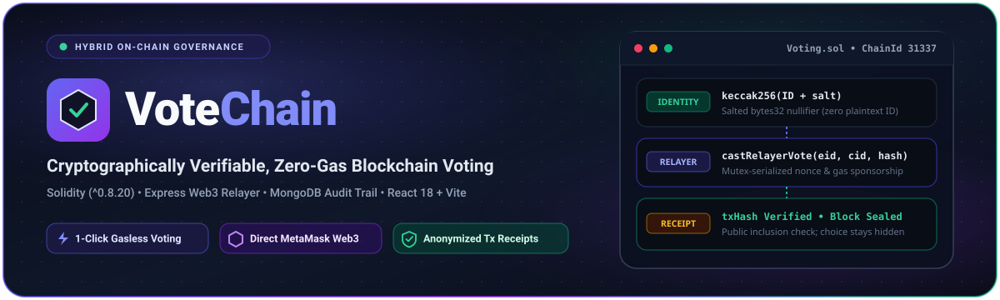
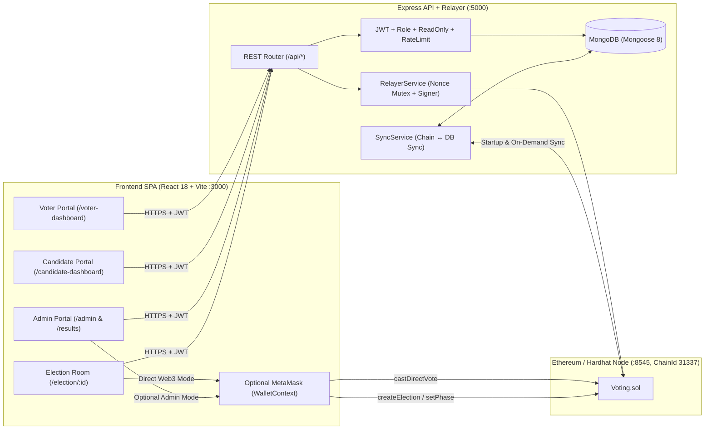

<div align="center">
  
  <br /><br />
  
  <h1>VoteChain — Hybrid Blockchain Voting System</h1>
  <p>
    <strong>Cryptographically Verifiable · 1-Click Gasless Relayer · Optional MetaMask Web3 · Role-Isolated Portals</strong>
  </p>
  <p>
    
    
    
    
    
    
    
    
    
  </p>
</div>

A full-stack, cryptographically verifiable, hybrid on-chain governance platform built with **Solidity smart contracts (Hardhat)**, a **Node.js/Express Web3 Relayer + MongoDB API**, and a **React + Vite + Tailwind CSS** web portal.

VoteChain eliminates Web3 onboarding friction by providing **1-Click Gasless Relayer Voting** (no wallet extension or cryptocurrency needed for standard constituents) alongside optional **Direct MetaMask Signing** for Web3 voters and election officers—complete with role-isolated portals for **Voters**, **Candidates**, and **Administrators**, sealed live tallies, anonymized cryptographic ballot receipts, bidirectional blockchain-to-database recovery, and read-only explorer accounts.

---

## Table of Contents

- [Architecture Overview](#architecture-overview)
- [Quickstart and Local Setup](#quickstart-and-local-setup)
- [Default Explorer and Admin Accounts](#default-explorer-and-admin-accounts)
- [Role Capabilities](#role-capabilities)
- [Technology Stack](#technology-stack)
- [Repository Structure](#repository-structure)
- [Smart Contract Architecture](#smart-contract-architecture)
- [Backend and Relayer Analysis](#backend-and-relayer-analysis)
- [Frontend Architecture](#frontend-architecture)
- [Database Schemas](#database-schemas)
- [REST API Reference](#rest-api-reference)
- [Security Privacy and Production Checklist](#security-privacy-and-production-checklist)
- [Testing and CI Pipeline](#testing-and-ci-pipeline)
- [License](#license)

---

## Architecture Overview

VoteChain bridges Web2 accessibility with on-chain immutability through a **Hybrid Relayer + Direct Web3** architecture:



### Hybrid Transaction Origin Matrix

| Role / Mode | Authentication & Verification | Where Blockchain Transactions Are Signed | Fallback Behavior |
| :--- | :--- | :--- | :--- |
| **Standard Voter (Default)** | 2-step email verification code + Gov/Student ID (`SHA-256` + salted `keccak256` `voterHash`) + JWT | **Backend Relayer (`RelayerService`)** checks DB eligibility and invokes `castRelayerVote`, paying gas. | Zero crypto, tokens, or browser extensions required. |
| **Web3 Voter (Optional)** | Constituent JWT + optionally linked MetaMask (`0x...`) | **Browser (`WalletContext` / `useVotingContract`)** calls `castDirectVote`, then logs anonymized receipt on `POST /api/votes/direct-record`. | Can toggle back to 1-Click Gasless mode inside `ElectionRoomPage`. |
| **Candidate** | 2-step email code + password + JWT | On approval by an Admin, the backend relayer mints the candidate onto `Voting.sol` (`addCandidate`). | Can view voting history, ended results, and verify receipts like a voter. |
| **Admin (Relayer Default)** | 2-step email code + password + JWT (no MetaMask needed) | **Backend Relayer** calls `createElection`, `setElectionPhase`, `addCandidate`, and `registerVoterHash`. | Operates fully on browsers without MetaMask installed. |
| **Admin (Web3 Mode)** | Admin JWT + optionally bound MetaMask (`POST /api/auth/admin/link-wallet`) | **Browser MetaMask** calls `createElection` / `setElectionPhase` (requires `owner` or `relayer` wallet). | Instant one-click switch back to **Backend Relayer (Default)**. |

---

## Quickstart and Local Setup

### Prerequisites
- **Node.js**: v18+ or v20+ (`ci.yml` targets Node.js 20)
- **MongoDB**: Local MongoDB running on `mongodb://127.0.0.1:27017` (or a MongoDB Atlas connection string)
- **MetaMask** *(Optional)*: Only needed for Direct Web3 Voting or Direct Admin MetaMask Signing

### Environment Variables

| Workspace | Template | Configuration Keys |
| :--- | :--- | :--- |
| `smart-contracts` | `.env.example` | `SEPOLIA_RPC_URL`, `PRIVATE_KEY`, `RELAYER_ADDRESS`, `ETHERSCAN_API_KEY` |
| `backend` | `.env.example` | `PORT` (`5000`), `NODE_ENV` (`development`), `MONGO_URI` (`mongodb://127.0.0.1:27017/blockchain_voting`), `JWT_SECRET`, `JWT_EXPIRES_IN` (`24h`), `RPC_URL` (`http://127.0.0.1:8545`), `RELAYER_PRIVATE_KEY` *(Hardhat Account #1 default)*, `CONTRACT_ADDRESS`, `HASH_SALT` |
| `frontend` | `.env.example` | `VITE_API_URL` (`http://localhost:5000/api`) |

> [!WARNING]
> Never commit real `.env` files, private keys, or production secrets. Default keys in `.env.example` and `backend/src/config/env.js` use publicly known Hardhat local test accounts intended solely for local development.

### Launch Stack in 3 Terminals

#### 1. Start Local Hardhat Node, Deploy & Seed
```bash
# Terminal 1 — Keep the local node running (RPC: http://127.0.0.1:8545, ChainId: 31337)
cd smart-contracts
npm install
npm run node
```

```bash
# Terminal 1b — Deploy contract and sync ABI/address to backend & frontend
cd smart-contracts
npm run deploy:local

# (Optional) Seed Election #1, 3 candidates, sample voter hashes, and open Voting phase
npm run seed:local
```

#### 2. Start Express Backend & Relayer
```bash
# Terminal 2 — Runs on http://localhost:5000 (/health and /api/*)
cd backend
npm install
cp .env.example .env      # Windows CMD: copy .env.example .env
npm run dev
```

#### 3. Start React + Vite Frontend
```bash
# Terminal 3 — Opens on http://localhost:3000
cd frontend
npm install
cp .env.example .env      # Windows CMD: copy .env.example .env
npm run dev
```

---

## Default Explorer and Admin Accounts

Seeded automatically on backend startup by `backend/src/utils/seedAccounts.js`:

| Account Type | Email | Password | Permissions |
| :--- | :--- | :--- | :--- |
| **Operational Admin** | `admin@election.gov` | `AdminPassword123!` | Full admin privileges *(auto-created only if no non-read-only admin exists)*. |
| **Voter Explorer (Demo)** | `demo.voter@election.gov` | `DemoVoter123!` | `isReadOnly: true` — Browse Voter Portal & election options; actions disabled; **undeletable**. |
| **Candidate Explorer (Demo)** | `demo.candidate@election.gov` | `DemoCandidate123!` | `isReadOnly: true` — Browse Candidate Headquarters & history; edits disabled; **undeletable**. |
| **Admin Explorer (Demo)** | `demo.admin@election.gov` | `DemoAdmin123!` | `isReadOnly: true` — Browse Admin Dashboard, Voters, & Audit Ledger; mutations disabled; **undeletable**. |

*(Each sign-in page includes a one-click **Auto-Fill** `DemoLoginBox` for the Read-Only Explorer accounts. Rotate or disable the default operational admin account before any internet-facing deployment.)*

---

## Role Capabilities

### Public / Voter Portal (`/voter-dashboard`, `/public-portal`, `/election/:id`)
- **2-Step Verified Registration (`/register`)**: Requires a 6-digit email verification code (`15m` expiry); hashes Government/Student IDs before database persistence.
- **4-Stage KYC Tracker**: Displays progress across `Registered` → `ID Submitted` → `Admin Approved` → `Synced On-Chain`. Rejected voters view feedback and can re-submit updated details/ID proof (`PUT /api/voters/profile`).
- **Live Turnout Monitor & Countdown**: Real-time 1-second countdown (`CountdownTimer`) and turnout percentage bar while keeping candidate vote tallies **sealed until `Ended`**.
- **Candidate Comparison (`CandidateComparisonSection`)**: Inspect full manifestos/agenda points or compare 2–3 candidates side by side before voting.
- **Cryptographic Vote Receipts (`VoteReceiptModal`)**: Displays `txHash`, block number, timestamp, and anonymized `voterHash` (omitting candidate choice), with **Copy Hash**, **Copy Vote Receipt** (JSON), **Download Receipt (`.json`)**, and **Verify My Receipt**.
- **Voting History & Receipt Verifier**: Browse past/active elections (`VotingHistorySection`), expand finalized results (`ElectionEndedBreakdown`), copy `VoteCast` hashes, verify receipts (`ReceiptVerifierWidget`), and manage KYC/ballot/closing notifications.

### Candidate Portal (`/candidate-dashboard`)
- **2-Step Registration (`/candidate-register`) & Nomination Desk**: Set official name, party/slate, target election (`Created` or `Registration` only), and manifesto.
- **Enforced Party & Election Locks**:
  - `draft`: All profile fields editable.
  - `pending`: Submitting for review locks party & edits.
  - `rejected`: Unlocks `party`, `name`, `electionId`, and `manifesto` with admin feedback; allows up to **2 reapplications** (`reapplicationCount <= 2`).
  - `approved`: Permanently locks `name`, `party`, and `electionId` on-chain while allowing continuous updates to **Campaign Manifesto & Key Policies** (`manifesto`, `photoUrl`).
- **Voter-Equivalent History & Receipt Tools**: Includes **Voting History & Ended Results** (highlighting elections `Contested by You` and matching voter receipts by email) and **Verify Receipt**.

### Election Administrator Portal (`/admin`, `/results`)
- **Wallet-Free Admin Onboarding (`/admin-register`, `/admin-login`)**: Standard verified email + password setup; optionally link MetaMask inside the dashboard (`linkAdminWallet`) and toggle **Backend Relayer (Default)** vs. **Direct MetaMask Signing**.
- **Election Lifecycle Control**: Deploy elections to `Voting.sol`, configure start/end timestamps, transition phases (`Created`, `Registration`, `Voting`, `Ended`), copy generated transaction hashes, and auto-sync approved voters when entering `Registration` or `Voting`.
- **Nomination Review & Voter KYC Desk**: Approve & mint self-nominated candidates on-chain or reject with feedback; approve voters (`syncTxHash` saved & logged as `VOTER_HASH_SYNCED`), reject KYC, and view/copy cast **Receipt Hash** values.
- **Full Account Directory & Self-Deletion (`Accounts` tab)**: Delete **Admin** (including self-deletion with immediate logout & redirect), **Voter**, and **Candidate** accounts while enforcing deletion protection (`403`) on all `isReadOnly` demo accounts.
- **Confidential Audit & Tallies (`/results`)**: Synchronized `ResultsChart`, **Verify Voter Receipt** with `Copy Verified Receipt`, and filterable **Immutable Audit Trail**.

---

## Technology Stack

| Layer | Technologies & Versions |
| :--- | :--- |
| **Smart Contracts** | Solidity `^0.8.20`, Hardhat `^2.22.0`, `@nomicfoundation/hardhat-toolbox ^4.0.0`, Chai `^4.3.7` |
| **Backend & Relayer** | Node.js, Express `^4.19.2`, Ethers.js `^6.11.1`, Mongoose `^8.3.1`, MongoDB |
| **Auth & Security** | `jsonwebtoken ^9.0.2`, `bcryptjs ^2.4.3`, `helmet ^7.1.0`, `cors ^2.8.5`, `express-rate-limit ^7.2.0`, Node `crypto` |
| **Frontend UI** | React `^18.2.0`, Vite `^5.2.0`, React Router `^6.22.3`, Tailwind CSS `^3.4.3`, Axios `^1.6.8`, Ethers.js `^6.11.1` |
| **Testing & CI** | Hardhat/Chai, Jest `^29.7.0`, Supertest `^6.3.4`, `mongodb-memory-server ^9.1.8`, GitHub Actions |

---

## Repository Structure

<details>
<summary>Expand full directory tree (smart-contracts, backend, frontend, CI)</summary>

```text
blockchain-voting-system/
├── .github/
│   └── workflows/
│       └── ci.yml                              # CI: Hardhat tests, Jest/Mongo API tests, Vite build
├── assets/
│   ├── banner.svg                              # README wide hero banner (vector SVG)
│   └── logo.svg                                # VoteChain hexagonal brand logo (vector SVG)
├── smart-contracts/                            # Hardhat + Solidity ^0.8.20
│   ├── contracts/
│   │   └── Voting.sol                          # Core on-chain voting contract (Relayer hash + Direct wallet)
│   ├── scripts/
│   │   ├── deploy.js                           # Deploys Voting.sol & auto-syncs ABI/address to backend & frontend
│   │   └── seed-local.js                       # Seeds Election #1, 3 candidates, sample voter hashes & voter1 wallet
│   ├── test/
│   │   └── Voting.test.js                      # Mocha/Chai tests for roles, phases, relayer & direct voting
│   ├── hardhat.config.js                       # Solidity 0.8.20 (optimizer 200), localhost (31337) & Sepolia
│   ├── .env.example
│   └── package.json
├── backend/                                    # Node.js + Express + Mongoose + Ethers v6 Relayer
│   ├── server.js                               # Entrypoint: DB connect, seed accounts, HTTP listen, background sync
│   ├── src/
│   │   ├── app.js                              # Express middleware (helmet, cors, morgan, json, /health, /api)
│   │   ├── config/
│   │   │   ├── contract.json                   # Auto-generated ABI + contract address from deploy.js
│   │   │   ├── db.js                           # Mongoose connection helper
│   │   │   └── env.js                          # Environment configuration with local dev defaults
│   │   ├── controllers/
│   │   │   ├── auditController.js              # Audit logs, tx receipt lookup, admin/chain tallies
│   │   │   ├── authController.js               # 3-role register/login, email codes, password reset, admin CRUD
│   │   │   ├── candidateController.js          # Candidate self-service, party/election locks, nomination review
│   │   │   ├── electionController.js           # Election CRUD, phase transitions, turnout privacy, public results
│   │   │   ├── voteController.js               # Relayer voting, direct vote recording, history, receipt verifier
│   │   │   └── voterController.js              # Voter KYC lifecycle, wallet linking, enriched voter list, alerts
│   │   ├── middleware/
│   │   │   ├── authMiddleware.js               # JWT verify + live MongoDB account existence check (+ optionalAuth)
│   │   │   ├── errorMiddleware.js              # Centralized JSON error formatter
│   │   │   ├── rateLimitMiddleware.js          # authLimiter (100/15m) & voteLimiter (30/1m)
│   │   │   ├── readOnlyMiddleware.js           # Blocks state mutations for isReadOnly demo explorer accounts
│   │   │   ├── roleMiddleware.js               # Role-based access control (voter, candidate, admin)
│   │   │   └── validateMiddleware.js           # Required request body field validation
│   │   ├── models/
│   │   │   ├── Admin.js                        # Admin schema (bcryptjs pre-save hash, optional walletAddress)
│   │   │   ├── AuditLog.js                     # Immutable action ledger (23 audited action types)
│   │   │   ├── Candidate.js                    # Dual manual/self-nominated candidate schema + reapplication tracking
│   │   │   ├── DeletedOnChainRecord.js         # Tombstones preventing re-import of deleted on-chain records
│   │   │   ├── Election.js                     # Election metadata, phase state, start/end schedule, totalVotes
│   │   │   ├── User.js                         # Voter schema (hashedGovId, voterHash, kycStatus, syncTxHash)
│   │   │   └── VerificationCode.js             # Role-scoped 6-digit registration code hashes (15m TTL)
│   │   ├── routes/
│   │   │   ├── index.js                        # Mounts /auth, /voters, /elections, /candidates, /votes, /audit
│   │   │   ├── auth.routes.js
│   │   │   ├── audit.routes.js
│   │   │   ├── candidate.routes.js
│   │   │   ├── election.routes.js
│   │   │   ├── vote.routes.js
│   │   │   └── voter.routes.js
│   │   ├── services/
│   │   │   └── relayerService.js               # Ethers v6 contract wrapper with serialized mutex & pending nonces
│   │   └── utils/
│   │       ├── cryptoHash.js                   # SHA-256 sensitive ID hashing + salted keccak256 voterHash
│   │       ├── seedAccounts.js                 # Seeds Chief Admin & 3 Read-Only Explorer accounts
│   │       └── syncService.js                  # Bidirectional MongoDB <-> Voting.sol reconciliation engine
│   ├── tests/
│   │   ├── api.test.js                         # Supertest API integration tests (auth, KYC, candidate locks, privacy)
│   │   └── syncService.test.js                 # Mocked-EVM unit/integration tests for chain <-> DB recovery
│   ├── .env.example
│   └── package.json
└── frontend/                                   # React 18 + Vite 5 + Tailwind CSS 3 + Ethers v6
    ├── index.html                              # Dark UI shell (Plus Jakarta Sans + JetBrains Mono)
    ├── tailwind.config.js
    ├── vite.config.js                          # Binds to 0.0.0.0:3000
    ├── .env.example
    ├── package.json
    └── src/
        ├── App.jsx                             # ErrorBoundary, ProtectedRoute & role routing
        ├── index.css                           # Tailwind CSS directives & fade-in animation
        ├── main.jsx                            # BrowserRouter -> AuthProvider -> WalletProvider -> App
        ├── abi/Voting.json                     # Auto-synced ABI + address from deploy.js
        ├── context/
        │   ├── AuthContext.jsx                 # JWT persistence, /auth/me hydration, role & isReadOnly flags
        │   └── WalletContext.jsx               # Optional MetaMask BrowserProvider, signer & event listeners
        ├── hooks/
        │   ├── useRegistrationCode.js          # Shared 2-step email verification code hook for registrations
        │   └── useVotingContract.js            # Direct Ethers v6 contract calls (vote, createElection, setPhase)
        ├── services/api.js                     # Axios client with automatic Bearer JWT interceptor
        ├── utils/format.js                     # Address/hash shorteners, date formatting, JSON receipt formatter
        ├── components/
        │   ├── BlockchainGuideModal.jsx        # Voter transparency & voterHash FAQ modal
        │   ├── CandidateCard.jsx               # Candidate summary card with compare & vote actions
        │   ├── CandidateComparisonSection.jsx  # Side-by-side (2-3 candidate) drawer & full bio modal
        │   ├── CopyButton.jsx                  # Clipboard copy control with visual confirmation
        │   ├── CountdownTimer.jsx              # Live 1s countdown badge with 24h closing alert pulse
        │   ├── DemoLoginBox.jsx                # Auto-fill read-only explorer credential card
        │   ├── ElectionCard.jsx                # Home ballot summary card with turnout & phase badge
        │   ├── ElectionEndedBreakdown.jsx      # Winner/tie banner, ResultsChart & VoteCast txHash table
        │   ├── ForgotPasswordForm.jsx          # Unified 3-step password reset UI (voter, candidate, admin)
        │   ├── Navbar.jsx                      # Responsive topbar with role links, wallet toggle & Register menu
        │   ├── PasswordInput.jsx               # Password field with show/hide visibility toggle
        │   ├── ReadOnlyBanner.jsx              # Persistent Read-Only Explorer Mode notice
        │   ├── ReceiptVerifierWidget.jsx       # Independent txHash verifier + copy verified JSON receipt
        │   ├── ResultsChart.jsx                # Animated percentage progress bars with leader highlight
        │   ├── VerificationCodeField.jsx       # 6-digit OTP input with issued-code auto-fill banner
        │   ├── VoteReceiptModal.jsx            # Post-vote receipt modal (Copy Hash, Copy Receipt, Download)
        │   ├── VotingHistorySection.jsx        # Shared Voter/Candidate election archive & receipt lookup
        │   └── WalletGuard.jsx                 # MetaMask gate component (optional Web3 guard)
        └── pages/
            ├── HomePage.jsx                    # Hero landing, architecture highlights, public ballot list
            ├── LoginPage.jsx                   # Voter login (/login, /voter-login)
            ├── RegisterPage.jsx                # Voter 2-step registration (/register, /voter-register)
            ├── ForgotPasswordPage.jsx          # Voter password reset
            ├── VoterDashboard.jsx              # Public Voter Portal (5 tabs)
            ├── ElectionRoomPage.jsx            # Hybrid 1-Click Relayer / MetaMask voting room
            ├── CandidateLoginPage.jsx          # Candidate login (/candidate-login)
            ├── CandidateRegisterPage.jsx       # Candidate 2-step registration (/candidate-register)
            ├── CandidateForgotPasswordPage.jsx # Candidate password reset
            ├── CandidateDashboardPage.jsx      # Candidate Headquarters (3 tabs)
            ├── AdminLoginPage.jsx              # Admin login (/admin-login)
            ├── AdminRegisterPage.jsx           # Admin 2-step registration (/admin-register)
            ├── AdminForgotPasswordPage.jsx     # Admin password reset
            ├── AdminDashboardPage.jsx          # Admin Control Center (6 tabs)
            └── ResultsPage.jsx                 # Admin Audit Trail, Receipt Verifier & Live Tallies (/results)
```

</details>

---

## Smart Contract Architecture

`smart-contracts/contracts/Voting.sol` (`pragma solidity ^0.8.20`):

- **Phase State Machine (`enum Phase { Created, Registration, Voting, Ended }`)**:
  - `Created (0)` & `Registration (1)`: Candidate additions (`addCandidate`) and voter whitelisting (`registerVoterHash`, `batchRegisterVoterHashes`, `registerVoterAddress`) enabled.
  - `Voting (2)`: Candidate additions locked; `castRelayerVote` and `castDirectVote` active.
  - `Ended (3)`: Voting closed and tallies frozen on-chain.
- **Role Modifiers**: `onlyOwner` (`transferOwnership`, `setRelayer`) and `onlyRelayerOrOwner` (`createElection`, `setElectionPhase`, `addCandidate`, voter registration, `castRelayerVote`). `castDirectVote` is open to any address in `registeredAddresses[electionId][msg.sender]`.
- **Double-Vote Prevention**: Independent on-chain nullifiers track `hasVotedHash[electionId][bytes32]` and `hasVotedAddress[electionId][address]`.
- **Auto-Sync Deployer (`scripts/deploy.js`)**: Deploys `Voting` with Hardhat Account `#1` as `relayer` and writes `{ address, network, chainId, abi, deployedAt }` to both `backend/src/config/contract.json` and `frontend/src/abi/Voting.json`.

---

## Backend and Relayer Analysis

- **Non-Blocking Startup (`backend/server.js`)**: Connects MongoDB, seeds default accounts, binds the Express HTTP server (`PORT=5000`), and runs `syncBlockchainAndDb()` asynchronously so the API remains responsive even when the RPC node is offline.
- **Serialized Transaction Relayer (`backend/src/services/relayerService.js`)**: Protects every contract write inside a Promise-chain mutex (`runWithLock`), reads `provider.getTransactionCount(wallet.address, "pending")`, and awaits `tx.wait(1)` to eliminate nonce collisions under concurrent voting.
- **Bidirectional Reconciliation (`backend/src/utils/syncService.js`)**:
  - *Chain → DB (`importChainElectionsToDb`)*: Pulls on-chain elections (`1..electionCounter`), candidates, and active whitelists while respecting `DeletedOnChainRecord` tombstones.
  - *DB → Chain (`syncMissingDbElectionsToChain` / `ensureElectionOnChain`)*: Automatically restores persistent MongoDB elections, approved candidates, approved voters, and target phases if an ephemeral local Hardhat node restarts, remapping `onChainElectionId` references across collections when needed.

---

## Frontend Architecture

- **Global Contexts**: `AuthContext` manages JWT storage, `GET /api/auth/me` session hydration, role flags, and `isReadOnly`; `WalletContext` manages optional `ethers.BrowserProvider` / MetaMask state and `accountsChanged` / `chainChanged` events.
- **Route Guards (`src/App.jsx`)**: `ErrorBoundary` and `ProtectedRoute` enforce strict access boundaries per role (`voter`, `candidate`, `admin`).

<details>
<summary>Expand Frontend Route Map (15 pages & role routes)</summary>

| Route | Access | Page Component |
| :--- | :--- | :--- |
| `/` | Public | `HomePage` |
| `/login`, `/voter-login` | Public | `LoginPage` |
| `/register`, `/voter-register` | Public | `RegisterPage` |
| `/forgot-password`, `/voter-forgot-password`, `/reset-password` | Public | `ForgotPasswordPage` |
| `/candidate-login` (`/candidate/login`) | Public | `CandidateLoginPage` |
| `/candidate-register` (`/candidate/register`) | Public | `CandidateRegisterPage` |
| `/candidate-forgot-password` (`/candidate/forgot-password`) | Public | `CandidateForgotPasswordPage` |
| `/admin-login` (`/admin/login`) | Public | `AdminLoginPage` |
| `/admin-register` (`/admin/register`) | Public | `AdminRegisterPage` |
| `/admin-forgot-password` (`/admin/forgot-password`) | Public | `AdminForgotPasswordPage` |
| `/election/:id` | Public (Voting requires `voter`) | `ElectionRoomPage` |
| `/voter-dashboard`, `/public-portal` | Protected (`voter`) | `VoterDashboard` |
| `/candidate-dashboard`, `/candidate/dashboard` | Protected (`candidate`) | `CandidateDashboardPage` |
| `/admin` | Protected (`admin`) | `AdminDashboardPage` |
| `/results` | Protected (`admin`) | `ResultsPage` |

</details>

---

## Database Schemas

<details>
<summary>Expand all 7 MongoDB / Mongoose schemas and audited event types</summary>

| Model | Purpose & Key Fields |
| :--- | :--- |
| `User` (`User.js`) | Constituent voter accounts: `fullName`, `email` (unique), `hashedGovId` (SHA-256 unique), `voterHash` (salted `keccak256` unique indexed), `password` (`bcryptjs`), optional `walletAddress`, `isApproved`, `kycStatus` (`registered \| id_submitted \| approved \| rejected \| synced_on_chain`), `rejectionReason`, `idProofName`, `idProofNote`, `syncTxHash`, `hasVotedElections[]`, `readNotificationIds[]`, `isReadOnly`, password reset fields. |
| `Candidate` (`Candidate.js`) | Dual manual/self-registered schema: `name`, `email` (unique sparse), `password`, `party`, `manifesto`, `photoUrl`, `electionId` (ref `Election`), `onChainElectionId`, `onChainId`, `voteCount`, `isApproved`, `approvalStatus` (`draft \| pending \| approved \| rejected`), `partyLocked`, `partyRequestCount`, `reapplicationCount`, `adminFeedback`, `isReadOnly`. |
| `Admin` (`Admin.js`) | Election officers: `fullName`, `email` (unique), `password` (`bcryptjs`), optional `walletAddress`, `role` (`"admin"`), `isReadOnly`, password reset fields. |
| `Election` (`Election.js`) | Off-chain election mirror: `title`, `description`, `onChainElectionId` (unique), `phase` (`Created \| Registration \| Voting \| Ended`), `startDate`, `endDate`, `contractAddress`, `totalVotes`. |
| `AuditLog` (`AuditLog.js`) | Indexed `txHash`, `voterHash`, `electionId`, `blockNumber`, `actorId`, `actorRole`, `details`. Supports 23 action enums: `VOTER_REGISTERED`, `VOTER_APPROVED`, `VOTER_REJECTED`, `VOTER_KYC_RESUBMITTED`, `VOTER_PROFILE_UPDATED`, `VOTER_DELETED`, `VOTER_HASH_SYNCED`, `ELECTION_CREATED`, `ELECTION_DELETED`, `PHASE_CHANGED`, `CANDIDATE_ADDED`, `CANDIDATE_REGISTERED`, `CANDIDATE_APPROVAL_REQUESTED`, `CANDIDATE_APPROVED`, `CANDIDATE_REJECTED`, `CANDIDATE_DELETED`, `REGISTRATION_CODE_REQUESTED`, `PASSWORD_RESET_REQUESTED`, `PASSWORD_RESET_COMPLETED`, `ADMIN_WALLET_LINKED`, `ADMIN_DELETED`, `RELAYER_VOTE_CAST`, `DIRECT_VOTE_RECORDED`. |
| `VerificationCode` (`VerificationCode.js`) | Stores SHA-256 `codeHash` and 15-minute `expiresAt` with unique composite index `(email, role)`. |
| `DeletedOnChainRecord` (`DeletedOnChainRecord.js`) | Tombstone markers (`type: election \| candidate`, `onChainElectionId`, `onChainId`, `label`) so `syncService` never re-imports deleted on-chain entries. |

</details>

---

## REST API Reference

Base URL: `http://localhost:5000/api` (plus `GET /health`).

<details>
<summary>Expand all 45 endpoints across /auth, /voters, /elections, /candidates, /votes, and /audit</summary>

### Authentication & Accounts (`/api/auth`)

| Method | Endpoint | Access / Guards | Purpose |
| :--- | :--- | :--- | :--- |
| `POST` | `/api/auth/request-registration-code` | Public, `authLimiter` | Issues a 6-digit registration code (`15m` TTL) for `voter`, `candidate`, or `admin`. |
| `POST` | `/api/auth/register` | Public, `authLimiter` | Registers a voter after verifying 6-digit code; generates `hashedGovId` & `voterHash`. |
| `POST` | `/api/auth/login` | Public, `authLimiter` | Voter login returning JWT & profile. |
| `POST` | `/api/auth/admin/register` | Public, `authLimiter` | Registers admin with 6-digit code (optional MetaMask wallet). |
| `POST` | `/api/auth/admin/login` | Public, `authLimiter` | Admin login returning JWT & profile. |
| `POST` | `/api/auth/admin/link-wallet` | `admin`, non-ReadOnly | Binds/updates optional MetaMask wallet (`0x...`) on Admin profile. |
| `GET` | `/api/auth/admins` | `admin` | Lists all admin accounts (excluding secrets). |
| `DELETE` | `/api/auth/admins/:adminId` | `admin`, non-ReadOnly | Deletes any non-read-only admin account (including self-delete). |
| `POST` | `/api/auth/candidate/register` | Public, `authLimiter` | Registers candidate with 6-digit code in `draft` state. |
| `POST` | `/api/auth/candidate/login` | Public, `authLimiter` | Candidate login returning JWT & nomination state. |
| `POST` | `/api/auth/forgot-password` | Public, `authLimiter` | Generates 6-digit password recovery code (`voter`, `candidate`, or `admin`). Blocked for Read-Only accounts (`403`). |
| `POST` | `/api/auth/reset-password` | Public, `authLimiter` | Resets password after verifying 6-digit reset code. |
| `GET` | `/api/auth/me` | Authenticated | Hydrates current user/candidate/admin profile from MongoDB. |

### Voters (`/api/voters`)

| Method | Endpoint | Access / Guards | Purpose |
| :--- | :--- | :--- | :--- |
| `GET` | `/api/voters/profile` | `voter` | Returns voter profile, resolved `kycStatus`, and 4-step `kycSteps`. |
| `PUT` | `/api/voters/profile` | `voter`, non-ReadOnly | Updates name / re-submits ID proof (`govId` editable until approved). |
| `POST` | `/api/voters/link-wallet` | `voter`, non-ReadOnly | Links MetaMask wallet & registers on-chain if already approved. |
| `GET` | `/api/voters/notifications` | `voter` | Returns dynamic alert feed (KYC, active ballots, 24h closing reminders, receipts). |
| `POST` | `/api/voters/notifications/read` | `voter`, non-ReadOnly | Persists notification IDs as read. |
| `GET` | `/api/voters` | `admin` | Lists voters (filterable `?status=approved\|pending`), enriched with `syncTxHash` and cast `receiptHash`. |
| `POST` | `/api/voters/:voterId/approve` | `admin`, non-ReadOnly | Approves voter and registers `voterHash` (+ linked wallet) on active chain elections. |
| `POST` | `/api/voters/:voterId/reject` | `admin`, non-ReadOnly | Rejects voter KYC with feedback so voter can re-submit. |
| `DELETE` | `/api/voters/:voterId` | `admin`, non-ReadOnly | Deletes non-read-only voter account and clears verification codes. |

### Elections (`/api/elections`)

| Method | Endpoint | Access / Guards | Purpose |
| :--- | :--- | :--- | :--- |
| `GET` | `/api/elections` | `optionalAuth` | Lists all elections with turnout stats; strips candidate `voteCount` and `totalVotes` until `Ended` unless caller is `admin`. |
| `GET` | `/api/elections/:id` | `optionalAuth` | Returns single election by MongoDB `_id` or `onChainElectionId` with same tally sealing rules. |
| `GET` | `/api/elections/:id/public-results` | `optionalAuth` | Returns winner/tie calculation, candidate tallies & anonymized `VoteCast` txHashes (`403` before `Ended` unless `admin`). |
| `POST` | `/api/elections` | `admin`, non-ReadOnly | Creates election on-chain (or stores client MetaMask tx result) + logs `ELECTION_CREATED`. |
| `PATCH` | `/api/elections/:id/phase` | `admin`, non-ReadOnly | Transitions phase (`Created \| Registration \| Voting \| Ended`) on-chain + auto-syncs approved voters. |
| `DELETE` | `/api/elections/:id` | `admin`, non-ReadOnly | Deletes election, creates tombstone, clears manual candidates & resets self-registered candidates to `draft`. |

### Candidates (`/api/candidates`)

| Method | Endpoint | Access / Guards | Purpose |
| :--- | :--- | :--- | :--- |
| `GET` | `/api/candidates/election/:electionId` | `optionalAuth` | Lists approved/on-chain candidates for an election; strips `voteCount` until `Ended` (unless `admin`). |
| `GET` | `/api/candidates/me` | `candidate` | Fetches authenticated candidate's nomination profile & populated election. |
| `PUT` | `/api/candidates/me` | `candidate`, non-ReadOnly | Edits profile (blocks edits while `pending`; locks `name`, `party`, `electionId` once `approved`). |
| `POST` | `/api/candidates/me/request-approval` | `candidate`, non-ReadOnly | Locks party and submits nomination (or reapplication, max 2) to admin review. |
| `GET` | `/api/candidates/admin/all` | `admin` | Lists all manual, seeded, and self-nominated candidates. |
| `GET` | `/api/candidates/admin/nominations` | `admin` | Lists self-registered candidate nominations (filterable by `?status=`). |
| `POST` | `/api/candidates/admin/nominations/:candidateId/review` | `admin`, non-ReadOnly | Approves (mints on-chain via Relayer) or rejects (unlocks party for edits) a candidate nomination. |
| `POST` | `/api/candidates` | `admin`, non-ReadOnly | Manually registers an approved candidate directly onto `Voting.sol` + MongoDB. |
| `DELETE` | `/api/candidates/:candidateId` | `admin`, non-ReadOnly | Deletes non-read-only candidate & adds chain tombstone if on-chain. |

### Votes & Verification (`/api/votes`)

| Method | Endpoint | Access / Guards | Purpose |
| :--- | :--- | :--- | :--- |
| `POST` | `/api/votes/relayer` | `voter`, non-ReadOnly, `voteLimiter` | Submits gasless relayer ballot (`Voting.castRelayerVote`), updates DB, returns anonymized receipt. |
| `POST` | `/api/votes/direct-record` | `voter`, non-ReadOnly | Records a direct MetaMask ballot `txHash` & anonymized turnout, returning receipt JSON. |
| `GET` | `/api/votes/history` | `voter` or `candidate` | Returns full election archive with `participated`, `contested` flag (for candidates), and matched receipt. |
| `GET` | `/api/votes/verify/:txHash` | `optionalAuth` | Verifies ballot inclusion against `AuditLog` + RPC `getTransactionReceipt` without leaking candidate choice. |
| `GET` | `/api/votes/status/:electionId` | `voter` | Checks `isApproved`, DB + on-chain `hasVoted` status, and returns `voterHash`. |

### Audit & Results (`/api/audit` — Admin Only)

| Method | Endpoint | Access / Guards | Purpose |
| :--- | :--- | :--- | :--- |
| `GET` | `/api/audit/logs` | `admin` | Queries audit trail (filterable by `electionId`, `action`, `limit`). |
| `GET` | `/api/audit/receipt/:txHash` | `admin` | Inspects any `AuditLog` transaction record + on-chain EVM confirmation & gas used. |
| `GET` | `/api/audit/results/:electionId` | `admin` | Fetches DB candidates alongside live `getElectionResultsFromChain` synchronization data. |

</details>

---

## Security Privacy and Production Checklist

### Implemented Cryptographic & Access Controls
- **Dual Identity Hashing (`cryptoHash.js`)**: Raw Government/Student IDs are never saved in plaintext; DB uniqueness uses `SHA-256(normalizedId)` and on-chain identity uses salted `keccak256(normalizedId + ":" + HASH_SALT)`.
- **Receipt Anonymity**: `RELAYER_VOTE_CAST` and `DIRECT_VOTE_RECORDED` logs, `/api/votes/verify/:txHash`, and `formatVoteReceiptText` record `txHash`, `blockNumber`, and `voterHash` while strictly omitting `candidateId` / `candidateName`.
- **Live Session Validation (`authMiddleware.js`)**: Every authenticated check verifies live account existence in MongoDB so deleted accounts lose access immediately (`401`).
- **Sealed Intermediate Results**: Candidate tallies and `Election.totalVotes` are stripped from non-admin endpoints until `phase === "Ended"`.
- **HTTP Hardening & Read-Only Guards**: `helmet()`, rate limiting (`authLimiter`: 100/15m, `voteLimiter`: 30/1m), `bcryptjs` password hashing, and `blockReadOnlyAccount` protection on all mutations.

### Production Deployment Checklist
Before moving from local Hardhat/dev mode to a public production deployment:
- [ ] **Rotate Secrets & Default Accounts**: Replace default `JWT_SECRET`, `HASH_SALT`, `RELAYER_PRIVATE_KEY`, and change/remove the seeded `admin@election.gov` credentials.
- [ ] **Wire Transactional Email**: Connect an SMTP provider (e.g., Nodemailer / SendGrid / SES) for registration & password-reset codes and remove plaintext codes from API responses.
- [ ] **Parameterize Network Chain ID**: Configure `RelayerService`'s `JsonRpcProvider` network/chain ID dynamically from `env` when targeting Sepolia or mainnet instead of `31337`.
- [ ] **Restrict CORS Origins**: Update `cors()` in `backend/src/app.js` from `*` to your deployed frontend domain.
- [ ] **Verify Direct On-Chain Logs & Phase Locks**: Validate RPC `VoteCastDirect` receipts server-side during `recordDirectVote`, restrict `Voting.sol` phase transitions to monotonic progression if desired, and consider commit-reveal or ZK proofs if strict on-chain tally secrecy is required prior to `Ended`.

---

## Testing and CI Pipeline

GitHub Actions (`.github/workflows/ci.yml`) executes three jobs on Node.js 20 across `main` / `master` pushes and pull requests:

1. **Smart Contracts (`smart-contracts/test/Voting.test.js`)** — Roles, election/candidate creation, phase locks, relayer & direct wallet voting, double-voting rejection:
   ```bash
   cd smart-contracts
   npm run compile && npm test
   ```
2. **Backend API & Sync Tests (`backend/tests/api.test.js`, `backend/tests/syncService.test.js`)** — Supertest + MongoDB (auto-falls back to `mongodb-memory-server`) covering 2-step auth, admin self-delete, read-only guards, candidate party locks/reapplications, password resets, KYC flow, turnout privacy, receipt verification, and chain reconciliation:
   ```bash
   cd backend
   npm test
   ```
3. **Frontend Production Build**:
   ```bash
   cd frontend
   npm run build
   ```

---

## License

MIT License. Built for transparent, accessible, and verifiable hybrid blockchain governance.
